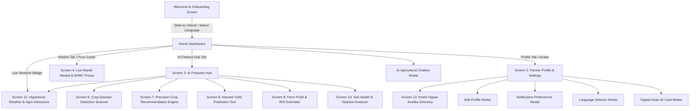

# 🌾 CropAI - Smart Farming & Agricultural Intelligence

<div align="center">

[](https://developer.mozilla.org/en-US/docs/Web/HTML)
[](https://developer.mozilla.org/en-US/docs/Web/CSS)
[](https://developer.mozilla.org/en-US/docs/Web/JavaScript)
[](https://github.com)
[](https://github.com)
[](https://opensource.org/licenses/MIT)

**An intelligent, multi-lingual agricultural companion empowering farmers with machine learning diagnostics, precision crop recommendations, harvest yield forecasting, real-time APMC Mandi commodity rates, hyperlocal agro-weather advisories, and digital farmer services.**

[Explore Features](#-key-features) • [AI & ML Suite](#-ai--machine-learning-suite) • [Real-Time APIs](#-live-apis--external-data-integrations) • [Liquid Glass UI](#-liquid-glass-design-system) • [Architecture](#-application-architecture--screen-flow) • [Quick Start](#-getting-started)

</div>

---

## 📖 Overview

**CropAI** (AI-Smart Farmers) is an advanced, responsive web application engineered to solve critical agricultural challenges faced by modern farmers. By combining data-driven agronomy with an intuitive mobile-first interface, CropAI bridges the gap between complex agricultural science and everyday farm operations.

From precision crop variety selection and automated disease diagnosis to live Mandi trade tracking and weather-based foliar spray windows, CropAI provides a comprehensive digital toolkit for farmers, extension officers, and agricultural researchers.

```
       🌱 Soil & Climate Metrics  ────────► [ Precision Crop Recommendation ]
       📸 Optical Leaf Diagnostic ────────► [ AI Disease Scanner & Treatment ]
       🌾 Land & Irrigation Data  ────────► [ Yield Prediction & Harvest Forecast ]
       📈 Government Agmarknet    ────────► [ Real-Time Mandi Prices & Ticker ]
       🌦️ Hyperlocal Forecast     ────────► [ Agro-Advisories (Spray / Irrig) ]
       🪪 Farmer Identity Records ────────► [ Digital Kisan ID & KVK Directory ]
```

---

## ✨ Key Features

### 1. 🤖 24/7 AI Agricultural Chatbot (2B-3B Finetuned Model)
- Conversational agronomic assistant delivering tailored guidance.
- Practical recommendations on fertilizer scheduling (NPK, DAP, urea), pest management, spray intervals, and harvest timing based on local conditions.
- Context-sensitive assistance accessible from anywhere in the app.

### 2. 🔬 Optical Leaf Disease Detection Scanner
- Visual plant health scanner simulating computer vision diagnosis.
- Instant pathogen identification (e.g., *Tomato Late Blight*, *Wheat Powdery Mildew*, *Cotton Bacterial Blight*).
- Delivers confidence percentages, severity indicators, botanical family categorization, symptom breakdowns, and prioritized 3-step chemical and organic action plans.

### 3. 🌱 Precision Crop Recommendation Engine
- Multi-parameter soil and environmental matching engine.
- Analyzes soil Nitrogen (N), Phosphorus (P), Potassium (K) in mg/kg, soil pH, annual rainfall (mm), ambient temperature (°C), and relative humidity (%).
- Returns the optimal crop variety (e.g., *Golden Wheat*, *Basmati Rice*, *Hybrid Cotton*, *Sweet Corn*) accompanied by a match score percentage, ideal sowing conditions, and custom fertilizer advisories.

### 4. 🚜 Harvest Yield Prediction & Forecasting
- Predictive agricultural modeling forecasting harvest volume (in Quintals).
- Calculates output based on selected crop variety (Wheat, Rice, Cotton, Maize, Soybean, Sugarcane), plot acreage, soil classification (*Black, Clay, Loam, Sandy*), and irrigation infrastructure (*Drip, Sprinkler, Flood*).

### 5. 💰 Farm Profit & ROI Estimator
- Interactive financial planning tool for agribusiness management.
- Evaluates estimated yield, operational cultivation expenditure, and prevailing market prices.
- Visualizes Total Revenue, Operating Costs, Net Profit, Profit Margin percentage, and Return on Investment (ROI) multiplier alongside dynamic cost-to-revenue ratio bars.

### 6. 🧪 Soil Health & Nutrient Analysis
- Circular SVG vitality gauge displaying an aggregated Soil Health Index (0 to 100).
- Real-time nutrient balancing for N, P, K, pH level, and soil moisture percentage.
- Automatic status badges identifying nutrient deficiencies (e.g., *Low Deficient Phosphorus*) with targeted remediation suggestions.
- Dual input mode: manual metrics entry or simulated Soil Health Card lab report scan.

### 7. 📈 Real-Time APMC Mandi Commodity Rates (Government Agmarknet API)
- Direct integration with Government of India Agmarknet data (`data.gov.in`).
- Tracks live market prices (modal, minimum, and maximum rates per quintal) across major crops: Tomato, Wheat, Cotton, Groundnut, Cumin (Jeera), Onion, Soybean, Sugarcane, and more.
- **GPS Reverse Geocoding**: Automatically detects the farmer's state (Gujarat, Maharashtra, Punjab, Uttar Pradesh, Rajasthan, etc.) via geolocation.
- Quick state filter chips, instant search by commodity or district, and a live horizontal ticker on the home screen.
- Resilient offline fallback dataset ensures uninterrupted access during network drops.

### 8. 🌦️ Hyperlocal Weather & Agricultural Advisories
- Dual-engine weather integration combining OpenWeatherMap API with high-resolution Open-Meteo fallback.
- **Dynamic Agro-Advisories**:
  - **Foliar Spray Window**: Checks wind velocity (< 15 km/h) and rain probability (< 20%) to prevent spray drift and chemical wash-off.
  - **Irrigation Guidance**: Accounts for heat levels, evapotranspiration rates, and impending rainfall to avoid water-logging and conserve water.
  - **Sowing Window Index**: Assesses ambient temperature and soil warmth for seedbed readiness.
- **Full-Day 24-Hour Timeline**: 3-hour interval forecast tagged with activity labels (*Ideal Spray*, *Drip Irrig*, *Peak Heat*, *Rain Watch*, *Field Safe*).
- 5-day weather outlook, humidity, wind speed, UV index, and sunrise/sunset times.

### 9. 🏛️ Krishi Vigyan Kendra (KVK) Directory & Kisan Helpline
- Searchable directory of ICAR-affiliated Krishi Vigyan Kendras across Indian states and districts.
- Includes host agricultural universities (AAU, JAU, PAU, YCMOU, etc.), institutional contact numbers with one-tap calling (`tel:`), district locations, and specialized research domains.
- Integrated Kisan Call Center toll-free helpline (`1800-180-1551`).

### 10. 🪪 Verified Digital Kisan ID Card
- Digital farmer identity card formatted with PM-KISAN and Aadhaar e-KYC verified standards.
- Dynamic QR code generation encoded with farmer credentials, land parcel size, APMC zone, and linked DBT bank status.
- One-tap export/sharing functionality to save the digital card directly to the device.

### 11. 📰 Real-Time Agricultural News & Policy Updates
- Live news stream powered by ApiTube.io (with verified fallback records).
- Categorized feeds covering Minimum Support Price (MSP) revisions, government subsidy schemes, weather alerts, and farming technology breakthroughs.

### 12. 🌐 Multi-Language Support & Accessibility
- Localized onboarding and settings supporting 5 major languages:
  - **English** (Default)
  - **ગુજરાતી** (Gujarati)
  - **मराठी** (Marathi)
  - **हिन्दी** (Hindi)
  - **తెలుగు** (Telugu)
- Persistent language selection saved across sessions.

### 13. 🌓 Dark Mode (Deep Black OLED) & Light Mode
- Seamless theme toggle between Deep Black (OLED-friendly for battery conservation in the field) and Clean White mode.
- System-wide CSS custom property adaptation with zero flicker on page reload.

---

## 🤖 AI & Machine Learning Suite

As documented in [`Models/model_info.md`](file:///c:/Users/hp/OneDrive/Documents/Agro-ai/Models/model_info.md), CropAI incorporates dedicated models and intelligence modules:

| # | Model / Engine | Architecture & Parameters | Operational Role |
| :--- | :--- | :--- | :--- |
| **1** | **AI Agricultural Assistant** | Finetuned 2B–3B parameter LLM | Delivers conversational crop recommendations, pest diagnostics, fertilizer timing, and APMC market analysis. |
| **2** | **Yield Prediction Model** | Multi-factor agronomic regression model | Predicts harvest output (Quintals) factoring crop variety, plot acreage, soil taxonomy (Black/Clay/Loam/Sandy), and irrigation infrastructure. |
| **3** | **Crop Recommender Model** | Supervised multi-class classification model | Analyzes 7 environmental inputs (N, P, K, pH, rainfall, temperature, humidity) to recommend the optimal crop variety with match confidence. |
| **4** | **Crop Disease Detection Scanner** | Optical leaf image diagnostic classifier | Identifies foliar pathogens (Late Blight, Powdery Mildew, Bacterial Blight) with confidence ratings, severity tiers, and treatment steps. |
| **5** | **Soil Health Vitality Analyzer** | Multi-parameter soil vitality scoring algorithm | Evaluates macro-nutrients (NPK), pH balance, and soil moisture against agronomic thresholds to score soil health from 0 to 100. |

---

## 🌐 Live APIs & External Data Integrations

| Service | Provider | Endpoint / Mechanism | Role in CropAI |
| :--- | :--- | :--- | :--- |
| **Mandi Commodity Rates** | [data.gov.in](https://data.gov.in/) (Agmarknet) | Resource ID `9ef84268-d588-465a-a308-a864a43d0070` | Live commodity trade prices (modal, min, max) across APMC mandis. |
| **Reverse Geocoding** | [BigDataCloud](https://www.bigdatacloud.net/) | Client-side Reverse Geocode API | Maps GPS coordinates (lat/long) to Indian state and district automatically. |
| **Hyperlocal Weather** | [OpenWeatherMap](https://openweathermap.org/) | Current Weather & 5-Day/3-Hour Forecast API | Real-time weather, temperature, humidity, wind speed, and precipitation. |
| **Agro-Weather Fallback** | [Open-Meteo](https://open-meteo.com/) | High-Resolution Hourly Forecast API | Zero-auth fallback providing 24-hour agro-meteorology and UV index. |
| **Agricultural News** | [ApiTube.io](https://apitube.io/) | Live News API | Real-time agricultural policy, MSP declarations, and weather bulletins. |
| **Digital QR Codes** | [QRServer](https://goqr.me/api/) | Dynamic SVG/PNG QR Generator | Generates scannable QR verification badges for Digital Kisan ID Cards. |

---

## 💎 Liquid Glass Design System

CropAI features a custom-built **Liquid Glass (VisionOS / Liquid Glassmorphism)** design aesthetic tailored for clarity under direct sunlight and high visual elegance:

- **Specular Meniscus Reflections**: Layered pseudo-elements (`::before`) creating organic convex liquid lens reflections across buttons and navigation tabs.
- **Ambient Caustic Refraction**: Subtle bottom-edge light dispersion (`::after`) mimicking light passing through dense crystal glass droplets.
- **Layered Elevation & Depth**: Multi-tier backdrop blurs (`backdrop-filter: blur(16px)` to `blur(24px)`), translucent white/dark panels, and soft multi-stop drop shadows.
- **Fluid Micro-Animations**: Interactive haptic depression on tap, spring-based hover elevations, smooth laser scanning animations, and tactile slide gestures.
- **Dual Display Chassis**: Renders as a native mobile experience on smartphones and fits within a sleek, centered mobile device shell on widescreen desktops and laptops.

---

## 📱 Application Architecture & Screen Flow



---

## 📂 Project Structure

```bash
Agro-ai/
├── index.html                           # Single-Page Application shell, 12 screen views & modals
├── main.css                             # Unified Liquid Glass design system, dark mode & layout
├── app.js                               # Core logic: Gov Mandi API, weather engine, AI calculations & state
├── SFPRODISPLAYMEDIUM.OTF               # Typography: Apple SF Pro Display typeface
├── ChatGPT Image Sep 22, 2026, 01_03_13 AM.png  # Brand logo asset
├── ChatGPT Image Feb 1, 2026, 06_48_04 PM.png   # Alternative graphic asset
├── assets/
│   ├── crop_recommendation_plant.png    # High-resolution plant hero banner graphic
│   └── user_avatar.jpg                  # Profile avatar image
├── Models/
│   └── model_info.md                    # Machine Learning models specification and architecture
└── README.md                            # Comprehensive project documentation
```

---

## 🚀 Getting Started

CropAI is engineered with pure Vanilla HTML5, CSS3, and JavaScript (ES6+). It has **zero build dependencies**, requires **no Node.js installation**, and launches immediately in any modern web browser.

### Prerequisites
- Any modern web browser: Google Chrome, Mozilla Firefox, Microsoft Edge, Apple Safari, or Brave.
- An internet connection for live API synchronization (fallback mode operates offline).

### Quick Launch

1. **Clone the repository:**
   ```bash
   git clone https://github.com/oye-rahul/AI-Smart-Farming.git
   cd AI-Smart-Farming
   ```

2. **Run locally:**
   - **Option A (Instant):** Double-click `index.html` to open it directly in your default browser.
   - **Option B (VS Code / Antigravity Live Server):** Right-click `index.html` and select **Open with Live Server**.
   - **Option C (Python HTTP Server):**
     ```bash
     # Python 3
     python -m http.server 8000
     ```
     Navigate to [http://localhost:8000](http://localhost:8000) in your browser.

---

## ⚙️ Configuration & API Keys

The application works out of the box with bundled API configurations and verified state fallbacks. To connect your personal API accounts:

1. **OpenWeatherMap API Key** (in [`app.js`](file:///c:/Users/hp/OneDrive/Documents/Agro-ai/app.js)):
   ```javascript
   const OPENWEATHER_API_KEY = 'YOUR_OPENWEATHER_KEY';
   ```
   *(If omitted, CropAI automatically falls back to Open-Meteo High Resolution Forecast API).*

2. **Government Mandi API (data.gov.in)** (in [`app.js`](file:///c:/Users/hp/OneDrive/Documents/Agro-ai/app.js)):
   ```javascript
   const GOV_API_KEY = 'YOUR_DATA_GOV_IN_API_KEY';
   const RESOURCE_ID = '9ef84268-d588-465a-a308-a864a43d0070';
   ```
   *(If the government server is throttled or offline, CropAI automatically loads verified state mandi caches).*

3. **News API (ApiTube.io)** (in [`app.js`](file:///c:/Users/hp/OneDrive/Documents/Agro-ai/app.js)):
   ```javascript
   const APITUBE_NEWS_KEY = 'api_live_YOUR_KEY';
   ```

---

## 🛠️ Tech Stack & Implementation Details

| Layer | Technologies Used | Implementation Details |
| :--- | :--- | :--- |
| **Structure & Markup** | HTML5 Semantic Standard | Screen-based SPA structure (`section.screen-view`), accessible ARIA attributes, modal overlays. |
| **Styling & Effects** | Vanilla CSS3 (Custom Properties) | Liquid glassmorphism, dynamic `@keyframes`, flex/grid responsive systems, dark theme CSS variables. |
| **Typography** | SF Pro Display, Google Inter & Manrope | Clean, high-legibility typographic scale across all resolutions. |
| **Application Logic** | Vanilla JavaScript (ES6+) | Asynchronous `fetch` APIs, geolocation detection, input calculation engines, `localStorage` caching. |
| **Graphics & Icons** | Apple Emojis & Scalable Vector Graphics | High-density Apple crop and weather icons, SVG circular health gauges, trend sparklines. |
| **Storage & Persistence** | Browser `localStorage` | Persists theme selection, language choice, farmer profile details, and notification toggles. |

---

## 🤝 Contributing

Contributions, issues, and feature proposals are warmly welcome!

1. Fork the Project (`https://github.com/oye-rahul/AI-Smart-Farming`)
2. Create your Feature Branch (`git checkout -b feature/NewAgriFeature`)
3. Commit your Changes (`git commit -m 'Add NewAgriFeature'`)
4. Push to the Branch (`git push origin feature/NewAgriFeature`)
5. Open a Pull Request

---

## 📄 License

Distributed under the **MIT License**. See `LICENSE` for more information.

<div align="center">
  <sub>Built with ❤️ for the global farming community.</sub>
</div>
